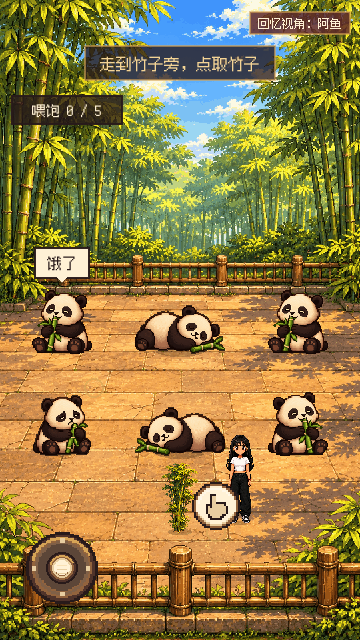
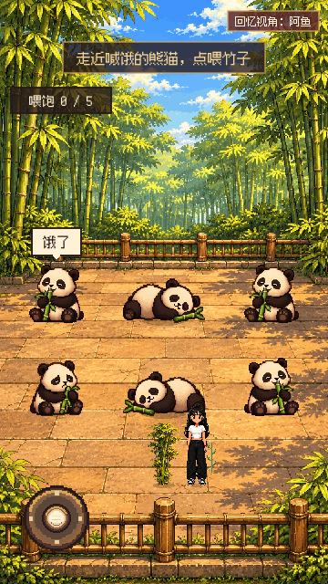
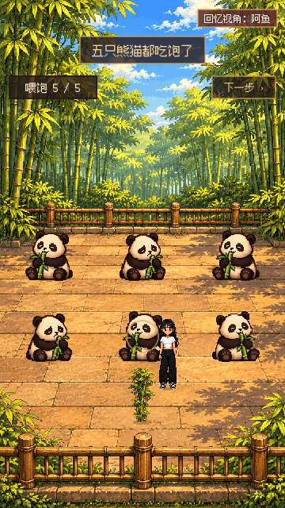

测试源码：`605009fb68de8c63265827098c621c3a3d8c5b62`；主线基线 `be510d0`；D2，2026-11-06 12:48 PST。

# D2-C1 多熊猫 · 待判

[单卡 PR #38](https://github.com/bardayu-cpu/changhong-village/pull/38)，未合并，Claude/D4/D1未判。

六只熊猫中随机一只喊饿。阿鱼走近竹子，点取物图标拿一根；走近喊饿的熊猫，再点喂食图标。喂过的持续切换吃竹帧，不再重复喊饿；五只不同熊猫吃饱后进原有群消息和墨水入位。远处点物件只走过去，不自动取或喂；摇杆、点地和明确互动均可用。

现有成都步骤 ID、A2-1a/1b 和群消息全部保留，旧档不会因为步骤改名退回序章。游戏内存档保存喂过的索引、当前喊饿对象、手中竹子、随机状态和脚点；重进时清除物理按住状态。统一「下一步」10秒后调用 `skip()`，补足最低五只，只结束本小游戏。

**依赖：D3-C1 新姿势图尚未交审。** 当前用旧 `idle/sleep/slow/eat` 帧展示六个实例，不能据此认定坐/躺/爬/抱竹新图已交齐。预留文件 `panda_sit.png`、`panda_lie.png`、`panda_climb.png`、`panda_hug.png`（`assets/w2/chengdu/`），透明底、脚底居中，入景大小约60×68；D3 可交坐标/尺寸后由 D2 对齐。吃竹暂交替 `panda_eat.png` / `panda_slow.png`。群聊中途2～3次通知属于 D2-C2；本卡不新增聊天或 B- 文案，只加5条 G- 操作提示。

## 开发验证

- [逻辑记录](D2-C1-2026-11-06/logic.log)：25项无失败，含五轮不同喂食顺序、不会自动取/喂、错误对象不消耗竹子、同一只不能重复计数、JSON续档、吃竹中刷新、第五只完成后刷新和最低结果。
- [原生输入记录](D2-C1-2026-11-06/touch.log)：20项无失败，使用 viewport 的鼠标/触摸事件，含第二指隔离、取消摇杆、前后台输入清除、五轮走近再喂和10秒「下一步」。从开发检查点进入成都，**不是从序章正常通关，也不是Web或微信真机体验**。
- `scene_state_test.gd`：既有17项无失败；测试退出有5个 ObjectDB 实例未释放警告。无脚本错误。
- K1合入回归：`call_hold_test.gd` 22项无失败，[记录](D2-C1-2026-11-06/k1-regression.log)；退出有14个测试实例未释放警告。a～d按住、d白闪后e～h点句、h后自动挂断与阿鱼前次明确补充一致；新卡摘要写a～h按住，已交D1统一口径，本卡未改K1。
- `make_chapters.py` 重生成、`sync_export_files.py` 更新 Web/微信资源表、`git diff --check` 通过。等待Claude审代码后再按已合主线出候选包。

## 三张原生 360×640 截图

## 本轮八章交接状态（D2开发记录，不代D4判过）

| 章 | 状态 | 原因／续做 |
| --- | --- | --- |
| 序章 | 阻塞 | D2-P1及D3-P1未交，本轮未做手机复验 |
| 上海 | 阻塞 | D2-S1/S2待做，本轮未做手机复验 |
| 成都 | 已修，待判 | 取竹/走路/喂食至少3种可见操作；A2两段旁白保留；新姿势图和中途群聊仍有独立卡 |
| 来电 | 阻塞 | K1开发回归无失败，D1待统一摘要；K2～K4待做 |
| 静冈/领证 | 阻塞 | J1/J2/J3/L1待做，接续先做J1 |
| 海南 | 阻塞 | H1与D3-H2待做 |
| 香港 | 阻塞 | G1与D3-G2待做 |
| 终章 | 阻塞 | F1/F3待做，已合F2本轮未复验 |

D4需基于合入后新包检查三秒可读、喂食即时音画反馈、五轮变化、走区/遮挡和手机刷新恢复；D1核对所有原稿编号及新G提示。D2不判自己的卡。
