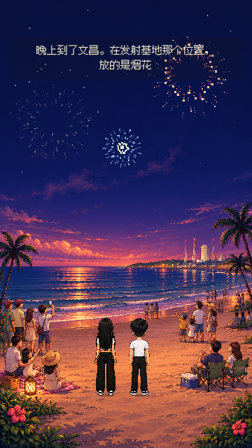
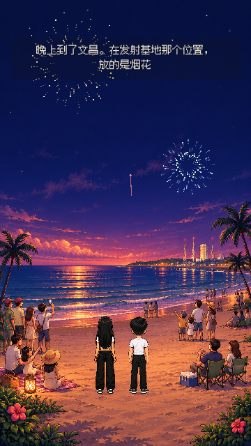
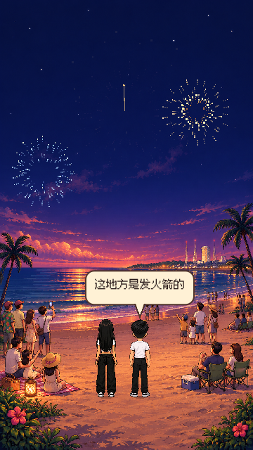

测试源码：`8bf127d`；依赖 UI2 PR #41；D2，2026-11-06。

# D2-H2 · 多人海滩烟花回忆 · 待判

按阿鱼明确要求，已将海南文昌段切换到新海滩背景：沙滩游客、远岸亮灯发射基地，两人站在前景一起观赏。五次点击烟花游戏已从章节移除，改为持续自动烟花、波光、倒影，原旁白 A5-2 与 A5-3a/b 两句对白均保留。说话时烟花继续；末句后自动观赏 8 秒，接火漆。无目标、计数、胜负、奖励页。

新图 `godot/hongyuan/assets/w2/hainan/bg_wenchang_memory_r2.png` 由内置 image_gen 生成并已实际接入。提示摘要：暖像素竖版夜海滩，匿名游客家庭共同看天空，远处文昌发射塔亮灯但无火箭升空，顶部留大幅夜空供运行时烟花，前景中央留两人站位；不烘焙主角、文字、UI 或烟花爆炸。D4 美术待判。原图保留。

13 项原生 360×640 检查无失败：实际背景可加载、无点击也有可见烟花变化、完整原稿、恢复同一烟花时刻、自动接火漆；17 项存档回归与 102 张流程截图无失败。第一次在导入尚未结束时截图出现占位底，已等待导入并增加资源可加载断言，重新渲染检查本目录的三张实际新图。证据为开发检查点，不是真机完整验收。

D4/D1/Claude 待判，未自行合并。后续温泉、迪士尼等继续接入同一候选链；此卡不代表整篇完成。
