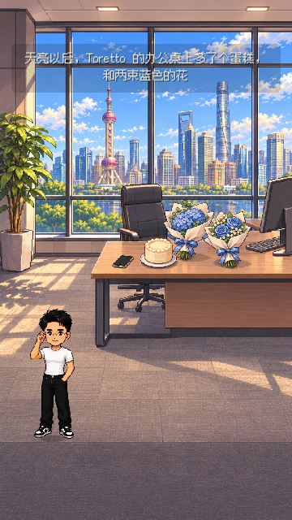
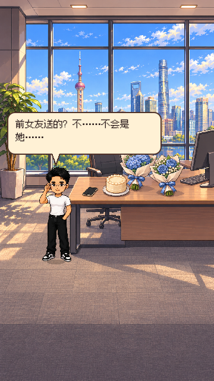
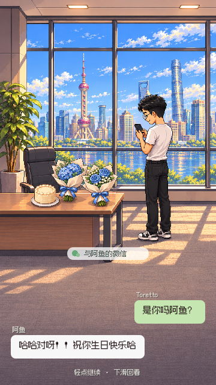
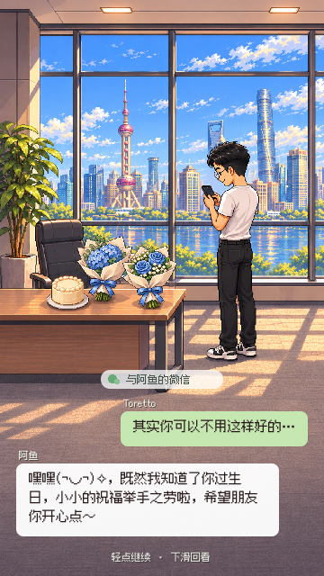

测试源码：`7f1ea53bfef435eb5002e1d90deedaa0daaaa245`；依赖 UI1 PR #39（f1ee650）；D2，2026-11-06。

# D2-K2 · CBD收礼与窗前微信，待判

上海CBD办公室中景，Toretto由玩家走到桌边。固定蛋糕A3-2j→两束蓝花A3-2k→手机顺序，仅下一个热点可见。收到礼物后切到窗前持iPhone给阿鱼发微信：人物/礼物/上海景色保持可见，消息在下方空地按发送/回复左右排列，取消全屏手机框与重复头像。A3-2l～2p五句原文不删，打字点按可即时显示，下一次点按进下一句；下滑回看，10秒按钮不能跳掉整段。

[24项原生360×640触摸/续档检查](D2-K2-2026-11-06/office.log)无失败，包含最新消息回看、快点不漏句、JSON恢复与最长回复排版。[既有全流程开发回归](D2-K2-2026-11-06/full-scenes.log)104张/0失败。均为开发检查点证据，不是真机完整通关或D4验收。

两张背景均用内置image_gen：`godot/hongyuan/assets/w2/call/bg_cbd_office_r2.png`与`bg_cbd_window_chat_r3.png`（941×1672）；原图保留。第一张无人物、使用原人物叠加；第二张依阿鱼明确要求画持机Toretto并标baked，代码关闭其他立绘和头像。[窗前图完整提示](D2-K2-2026-11-06/窗前持机图-生成提示.md)。收礼图提示：上海CBD落地窗与楼群、办公室中景，一只奶油蛋糕、分别包装的两束蓝花、黑色iPhone，左下留走路位置，暖像素、9:16，无人物/文字/UI。

D4美术/体验、D1核稿、Claude代码均未判。单卡K2叠加UI1，UI1合入后改基线hongyuan-launch。未自行合并或正式出包。阿鱼最新“人物z空间比例”继续由UI2逐场景校准，此卡不宣称全篇人物比例已解决。
