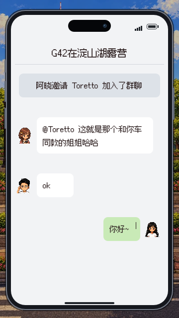
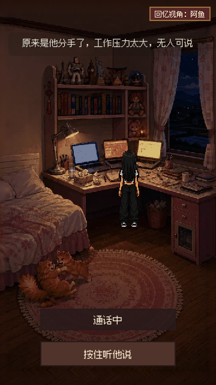
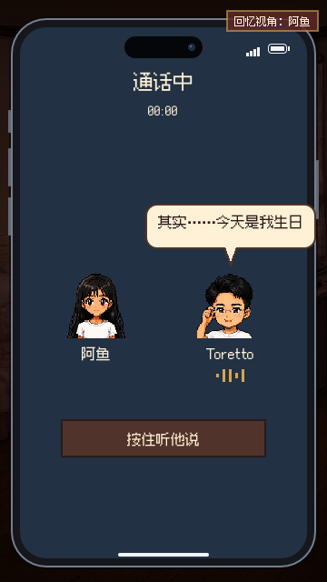

测试源码：`c97c6a29e47ad0b1767a5e9105d32e6fbc335e0d`；基线 `be510d0`；D2，2026-11-06。

# D2-UI1 · iPhone 与叙事镜头，待判

[PR #39](https://github.com/bardayu-cpu/changhong-village/pull/39)，未合并，未自判。

来源：阿鱼在D2工位明确要求手机是iPhone、旁白与人物对话可区分，以及双人通话/单人内心旁白分镜。

群聊、来电和Offer共用窄边框、圆角屏、胶囊前摄、侧键、底部手势条。群聊保留原四条内容与顺序。旧步骤、scene、来电字幕共用 `ui/story_caption.gd`：所有旁白放顶部y54，15号字、18%不透明度底衬、无金边；人物本人在场时用头顶米色气泡，尾巴指向说话人。角色不在场时保留头像姓名字幕。对白16号字，优先于过渡旁白。此版覆盖首次深底旁白方案。

电话里的旁白回到阿鱼自己的房间，只显示她；两人对白切双方通话，发声方有波形。疑惑来电显示阿鱼与来电人名称。接听按钮和扬声器位置已同步命中区域。K1按住/松开暂停、白闪后点句、自动挂断均沿用D1已定行为。

验证：[17项原生渲染/触摸检查](D2-UI1-2026-11-06/render.log)，七张360×640图、四条聊天均在屏内，接听/扬声器/Offer真实viewport触摸有效，顶部旁白和头顶浅色气泡的渲染检查无失败；[K1的22项回归](D2-UI1-2026-11-06/call-regression.log)无失败，退出时有14个测试实例未释放警告，无脚本错误。另跑全场景开发截图98张、0失败。测试从开发检查点进入，不是Web/微信真机完整通关。

办公室中景、浦岛酒店、静冈钓鱼路人和路亚动作分别由K2/J1/J3接续，未在本UI卡冒称完成。阿鱼原话已录入同目录新版规格末节；此卡未添加或删改任何剧情台词。

八章交接：序章、上海、成都、来电、静冈、海南、香港、终章均仍待最新合入包的手机全流程判定。来电UI已修；其余新版玩法缺项沿用D2-C1交接表，不能以这次UI自测标为通过。Claude审代码、D4审体验、D1核稿后方可合入出包。
