# P1 · 三处田园像素风样板

按 [Claude 与阿鱼的 P0 审定](../P0-审定-Claude.md) 制作。只审这三张原创样板；Claude 先审，再请阿鱼看实图。

**左：当前游戏，右：P1 样板。** 点击任一图看原始尺寸。三处均在 hongyuan-launch @ ff85800 的真实 Godot 婚礼场景同机位渲染。右图在隔离取景进程只换美术显示层，保留原人物、站位、镜头、门牌及界面。没有修改布局、碰撞、玩法或存档接口，也没有接进生产。

每张原始底图 1024×1536。四个交付尺寸覆盖 9:16、两种常用手机和 9:21；另测 9:17、9:18、9:19、9:20 的镜头出血。这里只验证样板机位，整块可走边缘、逐门往返和遮挡分层留到 P2/P3。详见 [绘图提示与校验](绘图提示与校验.md)。

## 湖边一角

亭、栈桥、船和月亮门按原有关系摆放；用暖光、青蓝水面和柳枝统一氛围。 [打开完整出血底图](底图/lake.png)。

| 整屏尺寸 | 现状 | 样板 |
| --- | --- | --- |
| 360×640 | [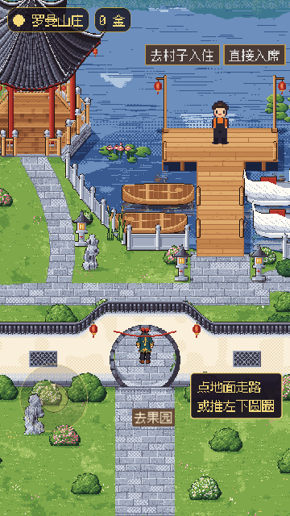](现状/lake-360x640.png) | [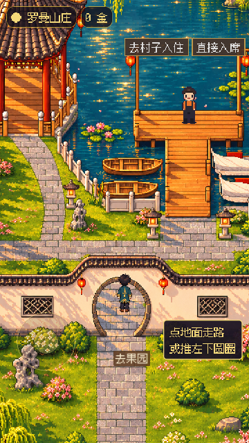](样板/lake-360x640.png) |
| 390×844 |  | [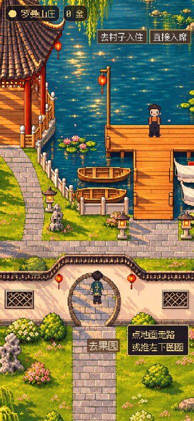](样板/lake-390x844.png) |
| 430×932 | [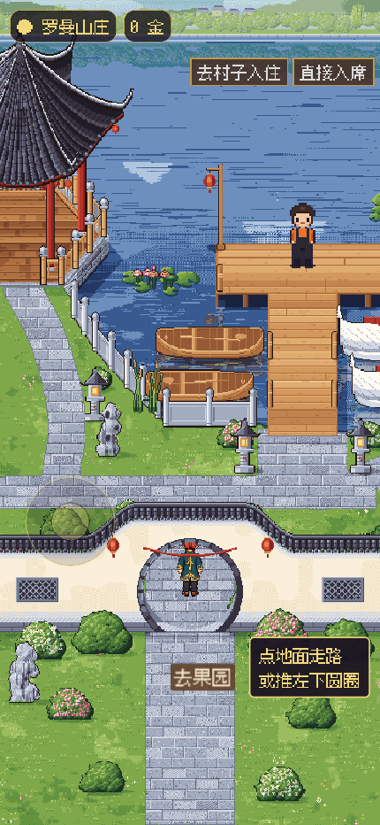](现状/lake-430x932.png) | [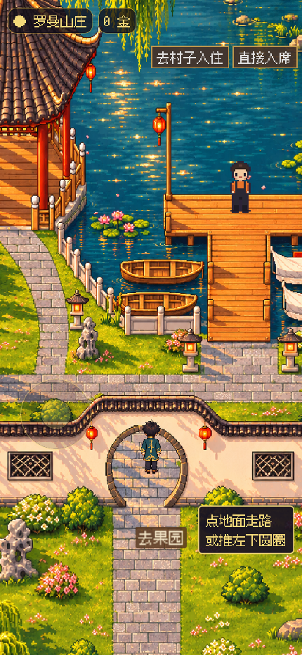](样板/lake-430x932.png) |
| 360×840（9:21） | [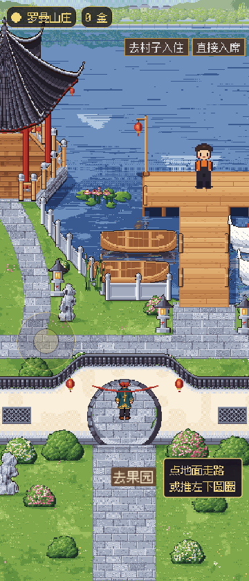](现状/lake-360x840.png) | [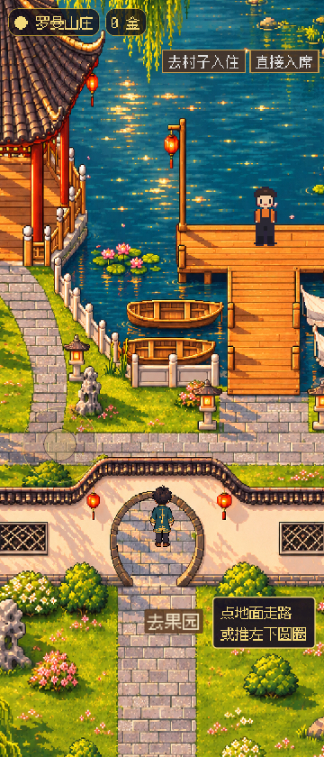](样板/lake-360x840.png) |

## 迎宾院

花墙、红毯、两台相机、签到台、回忆册和圆形铺地对照原位；围墙、花木与地面延续至屏外。 [打开完整出血底图](底图/court.png)。

| 整屏尺寸 | 现状 | 样板 |
| --- | --- | --- |
| 360×640 | [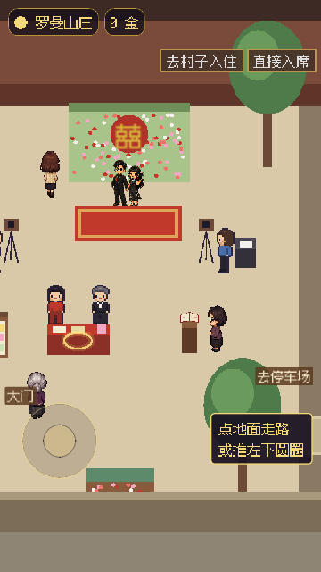](现状/court-360x640.png) | [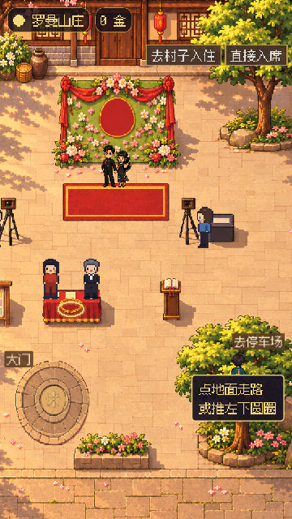](样板/court-360x640.png) |
| 390×844 | [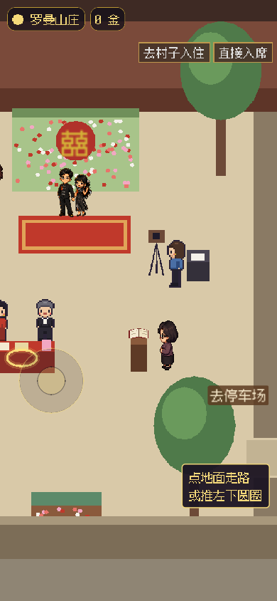](现状/court-390x844.png) | [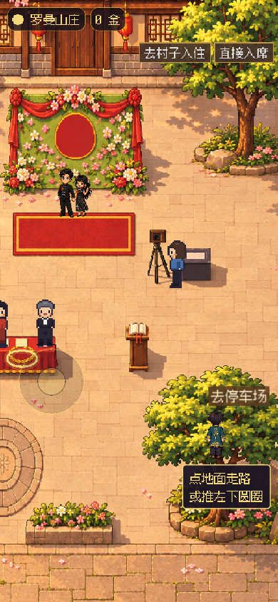](样板/court-390x844.png) |
| 430×932 |  | [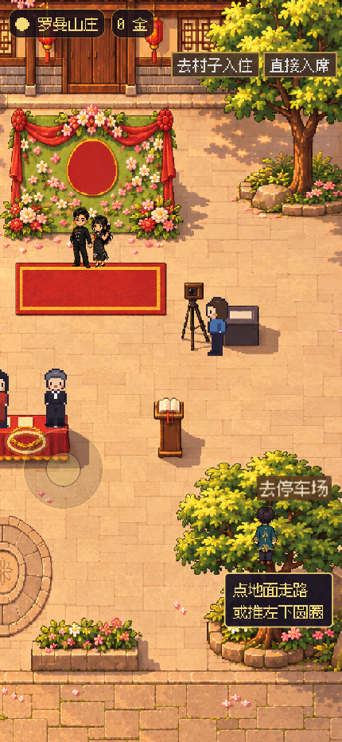](样板/court-430x932.png) |
| 360×840（9:21） | [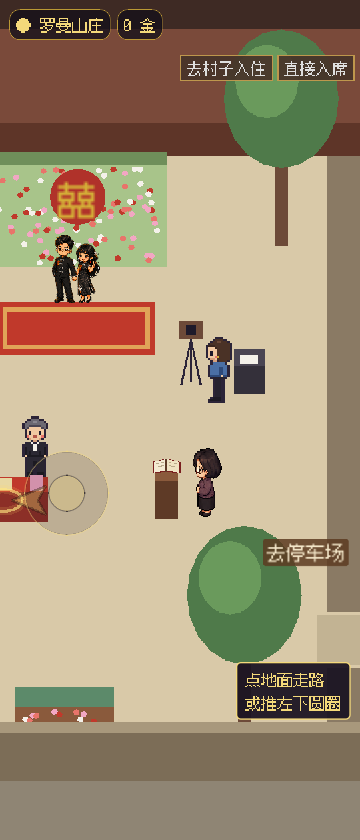](现状/court-360x840.png) | [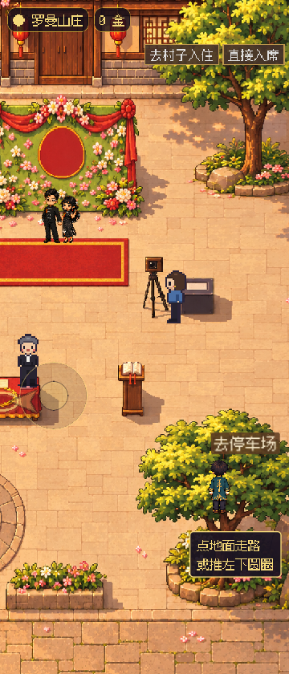](样板/court-360x840.png) |

## 小卖部

西侧门、上方柜台、右侧货架保留；可走地板外继续画墙基、石径和园景。 [打开完整出血底图](底图/shop.png)。

| 整屏尺寸 | 现状 | 样板 |
| --- | --- | --- |
| 360×640 | [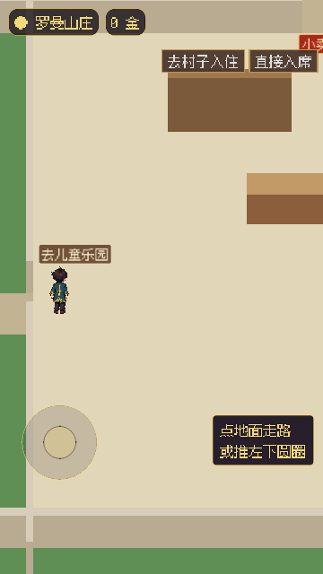](现状/shop-360x640.png) | [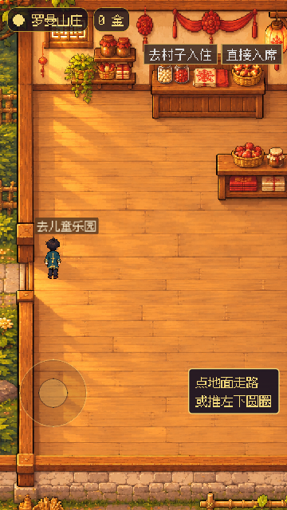](样板/shop-360x640.png) |
| 390×844 | [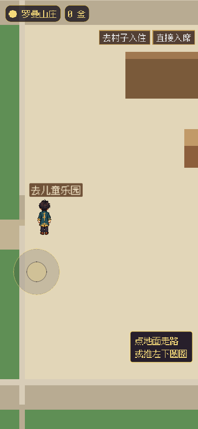](现状/shop-390x844.png) |  |
| 430×932 |  | [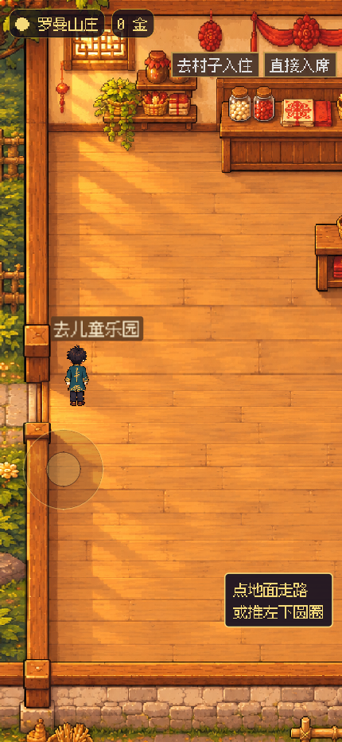](样板/shop-430x932.png) |
| 360×840（9:21） | [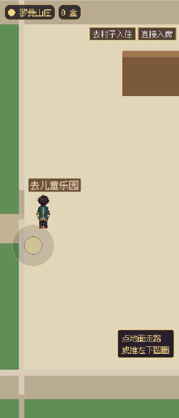](现状/shop-360x840.png) | [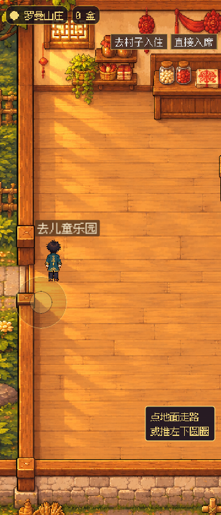](样板/shop-360x840.png) |

阿鱼要做的事：等 Claude 审阅后看三处实图，确认这套画风再进入 P3。
